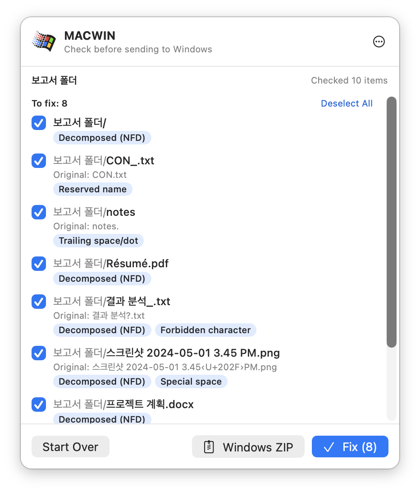
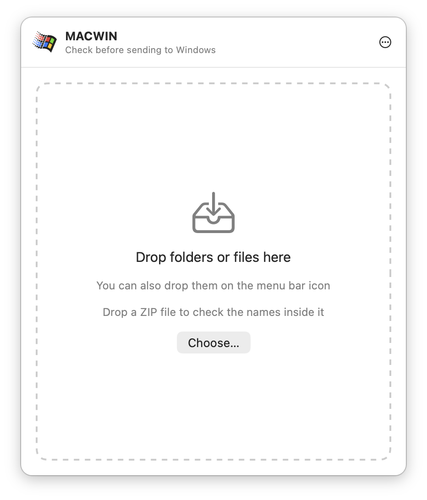
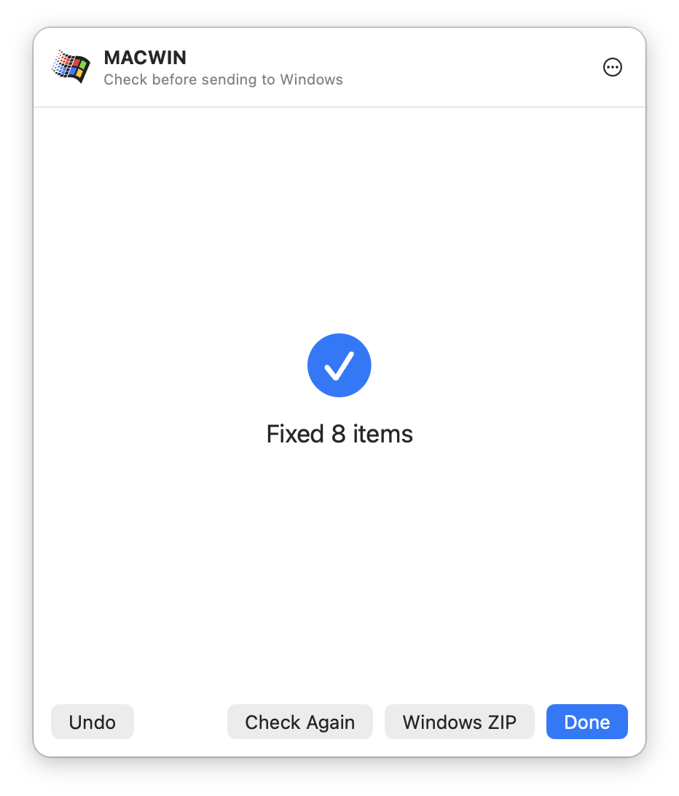
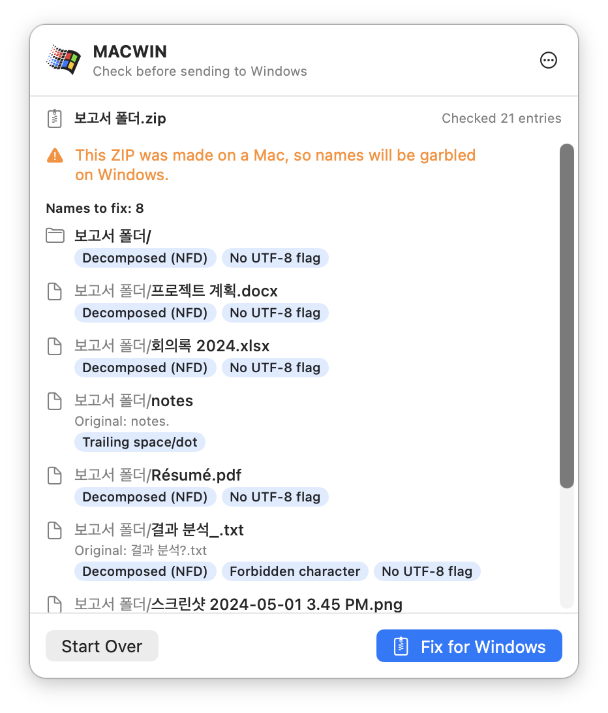
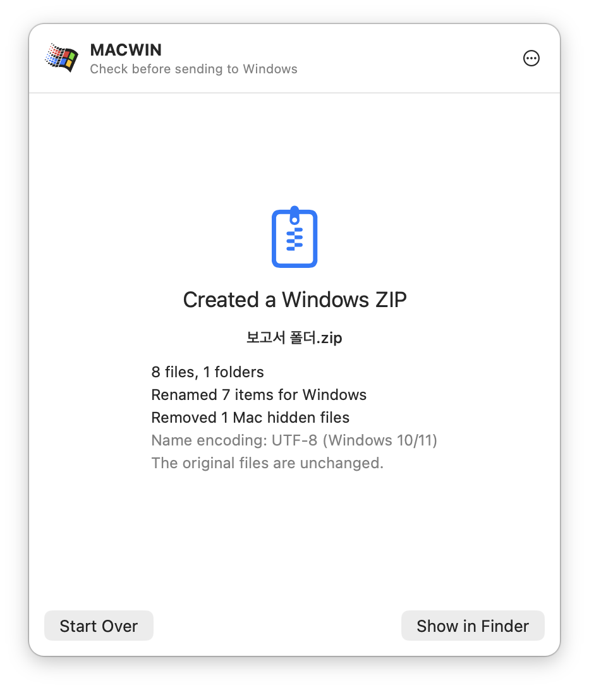

<p align="center">
  
</p>

<h1 align="center">MACWIN</h1>

<p align="center">
  <b>Fix Mac file names before they break on Windows.</b><br>
  A tiny macOS menu bar app: drop a folder, see what will break, fix it in place or zip it.
</p>

<p align="center">
  <a href="https://github.com/ysh038/MACWIN/releases/latest"></a>
  <a href="https://github.com/ysh038/MACWIN/releases"></a>
  
  
  
</p>

<p align="center">
  <a href="https://github.com/ysh038/MACWIN/releases/latest/download/MACWIN.dmg"><b>Download .dmg</b></a> ·
  <a href="https://github.com/ysh038/MACWIN/releases/latest/download/MACWIN.zip">Download .zip</a> ·
  <a href="#how-it-works">How it works</a> ·
  <a href="#installation">Install</a> ·
  <a href="#what-it-checks">What it checks</a>
</p>

<p align="center">
  <picture>
    <source media="(prefers-color-scheme: dark)" srcset="docs/screenshots/scanned-en-dark.png">
    
  </picture>
</p>

## Why

Korean (and accented, and Japanese) file names created on a Mac are stored in a different Unicode form (NFD) than Windows expects (NFC). Send such a folder to a Windows user and the names show up with their letters pulled apart — `한글` becomes `ㅎㅏㄴㄱㅡㄹ` — search can't find them, and some files won't copy at all. Mac-made ZIPs make it worse: Finder's "Compress" doesn't mark names as UTF-8, so Windows reads them as garbage, and a `__MACOSX` folder tags along.

MACWIN sits in your menu bar. Drop a folder (or a ZIP) on it before you send it, and it shows you exactly what would break and fixes it in one click.

## How it works

<table>
  <tr>
    <td align="center" width="33%">
      <picture>
        <source media="(prefers-color-scheme: dark)" srcset="docs/screenshots/idle-en-dark.png">
        
      </picture>
    </td>
    <td align="center" width="33%">
      <picture>
        <source media="(prefers-color-scheme: dark)" srcset="docs/screenshots/scanned-en-dark.png">
        
      </picture>
    </td>
    <td align="center" width="33%">
      <picture>
        <source media="(prefers-color-scheme: dark)" srcset="docs/screenshots/done-en-dark.png">
        
      </picture>
    </td>
  </tr>
  <tr>
    <td align="center"><b>1. Drop</b><br>Drag folders or files onto the menu bar icon or the window.</td>
    <td align="center"><b>2. Review</b><br>Each problem is tagged. Uncheck anything you want to leave alone.</td>
    <td align="center"><b>3. Fix</b><br>Rename in place (undo is one click away), or make a Windows-safe ZIP instead.</td>
  </tr>
</table>

### Already have a ZIP?

Drop a ZIP you made on a Mac and MACWIN checks the names inside it without extracting. **Fix for Windows** writes a `name (for Windows).zip` next to it: names are fixed, the UTF-8 flag is set, `__MACOSX` junk is gone, and the compressed data is copied byte for byte, so it's fast and the contents never change. Password-protected ZIPs work too.

<table>
  <tr>
    <td align="center" width="50%">
      <picture>
        <source media="(prefers-color-scheme: dark)" srcset="docs/screenshots/zip-en-dark.png">
        
      </picture>
    </td>
    <td align="center" width="50%">
      <picture>
        <source media="(prefers-color-scheme: dark)" srcset="docs/screenshots/zipped-en-dark.png">
        
      </picture>
    </td>
  </tr>
</table>

## Features

- **Three ways to fix** — rename in place (with undo), compress to a new Windows-safe ZIP, or repair a ZIP you already made.
- **Shows the original name** next to every change, with invisible characters made visible (`‹U+202F›`).
- **Safe by default** — never overwrites, skips `.git` and app bundles, leaves `.DS_Store` and friends alone, and records every rename so you can undo it.
- **Windows-safe ZIPs** — UTF-8-flagged names, no `__MACOSX` / `._*`, already-compressed files stored as is. A legacy CP949 mode for Windows 7 and old groupware.
- **Follows your system language** — English or Korean, picked from your Mac's preferred languages. (Korean screenshots are in [`docs/screenshots`](docs/screenshots).)
- **Small and native** — AppKit + SwiftUI, no dependencies, universal binary for Apple Silicon and Intel, macOS 13+.

## What it checks

| Check | Description | Action |
|---|---|---|
| Decomposed (NFD) | Converts Mac-style (NFD) characters — Korean, accented letters like `é`, Japanese kana like `が` — to Windows-style (NFC). The name looks the same. | Fixed |
| Special spaces | Replaces narrow no-break spaces (U+202F) and similar with a normal space, and removes zero-width characters. | Fixed |
| Control characters | Replaces invisible control characters with `_`. | Fixed |
| Forbidden characters | Replaces `\ : * ? " < > \|`, which Windows doesn't allow, with `_`. | Fixed |
| Trailing space/dot | Removes spaces and dots at the end of a name, like `memo. `. | Fixed |
| Reserved names | Appends `_` to names such as `CON`, `NUL` and `COM1`. | Fixed |
| No UTF-8 flag (ZIP) | The ZIP doesn't mark its names as UTF-8, so Windows misreads them. The flag is added. | Fixed |
| Name conflict | If a fixed name would clash with another file in the same folder, it's left unchanged and reported. | Warning only |
| Case conflict | Reports names that differ only in case, like `File.txt` / `file.txt`. | Warning only |
| Long path | Reports paths that may hit Windows' 260-character path limit. | Warning only |

What it leaves alone:

- Mac hidden files such as `.DS_Store`, `._*` and `__MACOSX` (only counted; removed from ZIPs)
- The inside of `.git` and `.svn` folders, and of bundles such as `.app`, Pages and Keynote files
- File **contents** (only names are changed)

## Installation

### Download

[Releases](https://github.com/ysh038/MACWIN/releases/latest) has two formats. They contain the same app, so pick whichever you like.

| File | How to install |
|---|---|
| [MACWIN.dmg](https://github.com/ysh038/MACWIN/releases/latest/download/MACWIN.dmg) | Open it and drag `MACWIN` onto the `Applications` folder in the window |
| [MACWIN.zip](https://github.com/ysh038/MACWIN/releases/latest/download/MACWIN.zip) | Unzip it and move `MACWIN.app` to your `Applications` folder |

After installing:

1. Launch `MACWIN` from the Applications folder. It doesn't appear in the Dock; look for the Windows logo in the menu bar.
2. On first launch you'll see a warning that Apple cannot verify the app is free of malware. This is because the app isn't signed and notarized with an Apple Developer ID. You only need to allow it once.
   1. Click **Done** in the warning dialog.
   2. Go to **System Settings → Privacy & Security**, click **Open Anyway** near the bottom, and enter your password (or use Touch ID).
      - On macOS 14 or earlier, you can also **right-click `MACWIN.app` → Open → Open**.
   3. Alternatively, run this once in Terminal. Use this as well if you see "is damaged and can't be opened".

      ```bash
      xattr -dr com.apple.quarantine /Applications/MACWIN.app
      ```

### Build from source

Requires Xcode or the Command Line Tools (`xcode-select --install`).

```bash
git clone https://github.com/ysh038/MACWIN.git
cd MACWIN
./build.sh
```

This creates `build/MACWIN.app`. Move it to the Applications folder and launch it. Release files (`dist/MACWIN.zip`, `dist/MACWIN.dmg`) are built with `./release.sh`.

### Launch at login

In **System Settings → General → Login Items**, click `+` and add `MACWIN.app`.

## Usage

1. **Drop the folders or files to check** — whichever is easiest:
   - Drag them from Finder onto the menu bar icon
   - Click the menu bar icon to open the window, then drag them into it
   - Use the **Choose…** button in the window
   - Drop **a single ZIP file** to check the names inside it (see [Fixing an existing ZIP](#fixing-an-existing-zip))
2. **Review the results**
   - **To fix**: only checked items are fixed. Uncheck anything you want to leave as is. When a name will change, the original is shown after **Original:**.
   - **Check yourself**: items that aren't fixed automatically. Rename them yourself if needed.
   - If nothing is wrong, you'll see **All clean**.
3. Choose one:
   - **Fix** (or Enter): renames the original files. Afterwards, **Check Again** confirms nothing is left.
   - **Windows ZIP**: leaves the originals alone and creates a new ZIP. See [Windows ZIP](#windows-zip) below.

The window closes when you click outside it or press Esc. It stays open while you're dragging files in.

The app follows your Mac's system language. It shows Korean or English, whichever comes first in your preferred languages, and English if neither is listed. You can also set it per app in **System Settings → General → Language & Region → Applications**.

### Windows ZIP

Click **Windows ZIP** on the results screen (or the screen after fixing) to create `FolderName.zip` next to the originals. If you dropped several items it's named `Archive.zip`, and a number is added if the name is taken, like `Archive 2.zip`. (When the app runs in Korean, the names are `보관.zip` and, for fixed ZIPs, `name (윈도우용).zip`.)

- Names inside the ZIP are fixed using the rules in the table above. The original files are not touched.
- If fixed names collide, a number is added, like `name (2).txt`.
- Mac hidden files such as `.DS_Store`, `._*` and `__MACOSX`, and symbolic links, are left out.
- Already-compressed formats (jpg, mp4, docx, pdf, etc.) are stored without recompressing, which keeps it fast.

Choose the **name encoding** from the `⋯` menu.

| Encoding | When to use it |
|---|---|
| UTF-8 (default) | Windows 10/11 File Explorer, Bandizip, 7-Zip and other modern tools |
| Legacy Windows (CP949) | Windows 7, or old groupware that garbles uploaded file names. Characters not in CP949, such as emoji, become `_`. The original names are stored too, so Bandizip and 7-Zip extract them with their original names. |

ZIPs over 4 GB or with more than 65,535 files can't be created yet.

### Fixing an existing ZIP

Drop a single ZIP file that was compressed on a Mac, and MACWIN checks the names inside it without extracting it.

- If any names would break on Windows, they're listed. Click **Fix for Windows** to create `name (for Windows).zip` next to the original ZIP.
- File contents are copied over exactly as compressed, so it's fast and the contents don't change. The original ZIP is left as is.
- The naming rules, removal of `__MACOSX` / `._*` / `.DS_Store`, and name encoding (UTF-8 / CP949) are the same as for Windows ZIP above.
- Password-protected ZIPs work too: only the names are fixed, and the password stays the same.
- Split archives (`.z01`, etc.) and ZIPs over 4 GB can't be fixed yet.

### Undo

Right after fixing, use **Undo** on the completion screen, or **Undo Last Fix** in the `⋯` menu at the top right of the window, to restore the original names.

Renames are recorded here:

- `~/Library/Application Support/MACWIN/last.json` — the last operation (used for undo)
- `~/Library/Application Support/MACWIN/history.log` — full history

## Things to know

- **Fix renames your original files directly.** If you don't want to touch the originals, use **Windows ZIP** instead.
- If a file with the new name already exists, it isn't overwritten; the rename is reported as failed.
- If other documents or code refer to a file by name (HTML links, paths in code, Excel external references, etc.), those links may break.
- In iCloud or Dropbox folders, renamed files will be synced again.

## Command line (for development)

```bash
swift build --product macwin-cli
.build/debug/macwin-cli scan <paths...>   # check only
.build/debug/macwin-cli fix <paths...>    # check and fix
.build/debug/macwin-cli zip [--cp949] [-o out.zip] <paths...>   # create a Windows ZIP
.build/debug/macwin-cli repair [--check] [--cp949] [-o out.zip] <existing.zip>   # fix an existing ZIP (--check: inspect only)
.build/debug/macwin-cli undo              # undo the last fix
```

## Project layout

UI text is written in English in the code via `tr("...")`. Korean translations live in `Resources/ko.lproj/Localizable.strings`, keyed by the exact English text.

```
Sources/
  ScrubCore/    Check/fix logic (Rules: naming rules, Scanner: folder scan, Fixer: rename and undo, Zipper: Windows ZIP, ZipRepair: fix existing ZIPs, Localization: tr())
  MACWIN/       Menu bar app (AppKit + SwiftUI); Demo.swift drives the app for screenshots
  macwin-cli/   Command-line tool
build.sh        Builds build/MACWIN.app (universal)
release.sh      Builds dist/MACWIN.zip and dist/MACWIN.dmg
Resources/      Icon images, AppIcon.icns, ko.lproj/Localizable.strings (Korean UI text)
scripts/make-icns.swift           Regenerates Resources/AppIcon.icns
scripts/capture-screenshots.sh    Regenerates docs/screenshots (needs Screen Recording permission)
docs/screenshots/                 README screenshots, English and Korean, light and dark
```

## Credits

- Icon: Windows icon by [Icons8](https://icons8.com) (free license; also credited in the app under `⋯` → **About MACWIN**)
